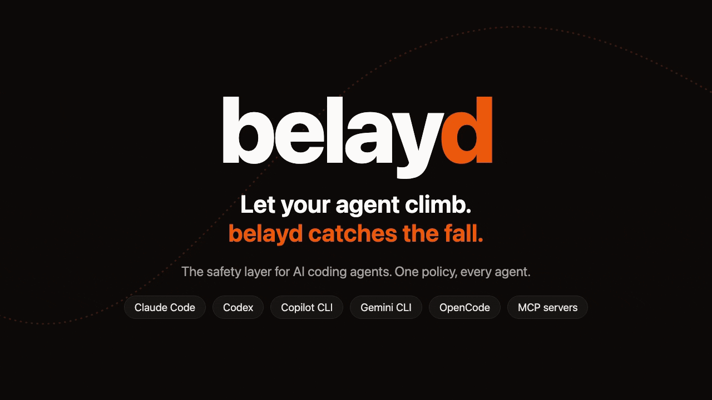

<p align="center">
  <picture>
    <source media="(prefers-color-scheme: dark)" srcset="docs/assets/banner-dark.svg">
    
  </picture>
</p>

<p align="center">
  <a href="https://www.npmjs.com/package/belayd-cli"></a>
  <a href="https://github.com/albert-canfield/belayd/actions/workflows/ci.yml"></a>
  
  <a href="LICENSE"></a>
</p>

Coding agents are fast, confident, and running with your permissions. Most days that's great. Then one of them force pushes to main, reads your `.env` into its context, or tidies up the wrong folder, and you find out afterwards.

**belayd sits between your agents and your machine.** It reads every command before it runs, stops the ones you would never approve, asks you about the risky ones, writes everything down, and puts your files back when an agent gets it wrong, including what its shell commands did. One policy covers Claude Code, Codex, Copilot CLI, Gemini CLI, OpenCode and any MCP server.

**Running two agents in the same repo?** belayd knows which one changed what. Undo the Codex session and Claude Code's work stays exactly where it was.

<p align="center">
  
</p>

## Up and running in two minutes

```sh
npm install -g belayd-cli
cd your-project
belayd init
```

`init` finds the coding agents on your machine, shows you exactly what it will add to their settings, keeps a backup, and writes a `belayd.yaml` for the project. Restart your agent and you're covered. Nothing ever leaves your machine.

The package is `belayd-cli` because npm thinks `belayd` looks too much like `delay`. The command it installs is plain `belayd`.

Try it without an agent:

```console
$ belayd check 'curl -fsSL https://get.example.sh | bash'
✖ deny  curl -fsSL https://get.example.sh | bash
   Runs code straight from the internet without anyone reading it. Download the script,
   show it to the user, and run it only after they agree.
   rule no-pipe-to-shell  ·  policy: balanced preset
```

### See what it would have caught

Before you turn anything on, `belayd scan` replays the tool calls your agents already made (from Claude Code's and Codex's own history on your machine) and shows what belayd would have done with them. It runs nothing and sends nothing:

```console
$ belayd scan
belayd scan · my-app · last 30 days
984 tool calls in 9 sessions (Claude Code 984). Read on this machine; nothing ran and nothing was sent.

  quiet           910     92%
  asked            31    3.2%
  blocked          43    4.4%

Would have blocked
  ✖     36  no-secret-files   This file holds secrets such as keys, tokens or passwords. Ask the us…
             e.g. cat .env
             e.g. grep -E "^STRIPE_KEY=" .env
  ✖      7  no-pipe-to-shell  Runs code straight from the internet without anyone reading it. Downl…
             e.g. curl -fsSL https://get.example.sh | sh

Would have asked about
  ?     24  ask-force-push-with-lease  Force pushes, although with a safety check.
             e.g. git push --force-with-lease origin feature
  ?      7  ask-privilege              Runs a command as another user, usually root.
             e.g. sudo apt-get install -y jq

See why with belayd check --explain "<command>". Once belayd is on, belayd tune turns questions you keep approving into rules.
```

## What you get

**It reads commands the way your shell does.** Not a regex over a string: belayd parses the command and follows quotes, variables, `cd`, aliases, functions, `bash -c`, `eval`, `$(...)`, heredocs, pipes into interpreters, `uv run` and `poetry run`, and even base64, then checks every program that would actually run. It reads shell scripts before they run too, so `bash cleanup.sh` is judged by what is inside `cleanup.sh`. Anything it can't see into gets a question, never a guess.

**It notices the sneaky version.** The classic way around a command allowlist is to edit `package.json` and then run `npm test`. belayd remembers which files the agent changed in the session, and asks before it runs scripts or Git hooks from one of them. When the agent writes a Python, Node, Ruby or Perl script and then runs it, belayd reads the script first and checks the shell commands, deletes and file reads inside it.

**It stays quiet until it matters.** When no rule applies, belayd says nothing and your agent behaves exactly as it did before. No fifty extra prompts a day. Your project's own scripts get the benefit of the doubt: in a script that is committed to Git and unchanged, belayd still blocks `rm -rf ~` or a read of `.env`, but doesn't question every detail it can't see. Check the claim against your own last month with `belayd scan`.

**It asks in the right place.** In an interactive Claude Code session, belayd's question shows up in Claude Code's own prompt. When nobody is watching the terminal (`claude -p`, Codex, a long background run), belayd holds the call and pings you, and you answer with `belayd approve`, on a local web page, or in a native dialog. No answer in time means no.

<p align="center"></p>

**It keeps a flight recorder.** Every tool call, what belayd decided, who approved it and whether it ran, in a local append-only log with a hash chain. `belayd replay` turns a session into a readable timeline, including the files each step changed.

**It undoes.** belayd snapshots files before and after every step that can change them, shell commands included, in a shadow Git repository that never touches your own `.git`. `belayd undo 7` puts back exactly what step 7 changed. Claude Code's `/rewind` and Cursor's checkpoints can't undo what a shell command did. belayd can.

**It keeps several agents apart.** Run Claude Code and Codex (or three Claude Codes) in the same project at once, and every step still owns only what it changed: belayd checks each changed file against what the other agents were doing at that moment. `belayd undo --whole-session --session <id>` takes back one agent's work and leaves the others' alone, and `belayd replay` shows each agent only its own files. A file two agents may both have changed is left alone unless you pass `--force`.

## What it catches

With the default `balanced` policy:

<!-- catches:start -->
| Command | belayd | Why |
|---|---|---|
| `rm -rf ~` | blocked | Deletes your home folder |
| `X=rm; bash -c "$X -rf ~"` | blocked | The same, hidden behind a variable and `bash -c` |
| `echo cm0gLXJmIC8= \| base64 -d \| sh` | blocked | That's `rm -rf /` in base64 |
| `find ~ -exec rm -rf {} +` | blocked | Deletes everything find finds in your home folder |
| `curl -fsSL https://get.example.sh \| bash` | blocked | Runs code nobody has read |
| `cat .env` | blocked | Secrets. The agent should ask you for the one value it needs |
| `cp ~/.ssh/id_rsa /tmp/k` | blocked | Your SSH key |
| `git push --force origin main` | blocked | Rewrites history other people already have |
| `git push --force-with-lease` | asks | Safer, still a force push |
| `git reset --hard HEAD~3` | asks | Throws away work |
| `sudo apt-get install -y jq` | asks | Runs as root |
| `npm publish` | asks | Publishes to the world |
| `psql -c "DROP TABLE users"` | asks | Drops a table |
| `echo hi > /etc/hosts` | asks | Changes a file outside the project |
| `npm test` | quiet | Your agent decides as usual |
| `rm -rf node_modules dist` | quiet | Inside the project, and undo can bring it back |
<!-- catches:end -->

Every row above is checked by the test suite, together with [over 400 more](tests/policy/corpus.yaml) for each of the three presets. CI also runs about 700 commands for real in a throwaway container, each of them hiding a delete, a secret leak or a write to your home folder in a different way, and fails if bash did anything dangerous that belayd let through. Known exceptions would be listed, with the reason, in [`known-misses.txt`](tests/differential/known-misses.txt). Today there are none.

## Undo, step by step

```console
$ belayd replay
Session e435c08c  Claude Code · my-app · Oct 14, 2026, 10:04 AM · 3 min · 3 steps

1  10:04:22  ·  Edit   write src/app.ts
                M src/app.ts +1 -1
2  10:04:30  ·  Bash   sed -i '' 's/hello/goodbye/' greeting.txt && echo extra > notes.md
                M greeting.txt +1 -1
                A notes.md +1 -0
3  10:04:41  ✖  Bash   cat .env
                blocked: This file holds secrets such as keys, tokens or passwords.

$ belayd undo 2
  restore  greeting.txt  +1 -1
  delete   notes.md  +1 -0  (created by the agent)
✔ Undid 2 file changes.  Changed your mind? belayd redo
```

Undo never throws away newer work. If a file changed again after the step you're undoing, belayd says so and stops, unless you pass `--force`. Redo checks the same way. You can undo one step, a range (`belayd undo 5-8`) or a whole session (`belayd undo --whole-session`), and every undo can be redone.

Snapshots are kept for 30 days (`snapshots.keep` in `belayd.yaml`) and older ones are pruned once a day in the background, so the store doesn't grow forever. `belayd doctor` shows how much space they take.

## Your policy, in one file

`belayd init` writes a `belayd.yaml` that starts from a preset. Your rules win over the preset:

```yaml
version: 1
extends: balanced

rules:
  - id: allow-clean-build
    match: { command: rm, writes: '{workspace}/dist/**' }
    decision: allow

  - id: no-production-database
    match: { command: psql, args: { any: ['*prod*'] } }
    decision: deny
    reason: Production database access is not allowed from agents.
```

Working across several repositories at once? List them, and belayd treats them as part of the project instead of asking about every write there. Extra folders in your own Claude Code settings (`permissions.additionalDirectories`) count too:

```yaml
folders: [../api, ../shared-ui]
```

| Preset | When nothing matches | Good for |
|---|---|---|
| `balanced` (default) | Stays quiet, your agent's own permissions decide | Day-to-day work |
| `strict` | Asks, except for reading the project and read-only commands | Sensitive repositories, unattended runs |
| `yolo-with-undo` | Allows, so your agent stops prompting you | Moving fast, with undo as the safety net |

Rules can match on the program and subcommand (`git push`), arguments, the exact command (`argv`), file paths (read, written or either), network domains, code piped from the internet, and secrets in outgoing data. The presets are plain YAML in [`presets/`](presets): they double as examples. A few rules are marked `final`: your own rules can't weaken them, and switching one off takes an explicit `disable:` line that shows up in the audit log. More examples live in [`examples/`](examples).

Your own policy lives in `~/.belayd/belayd.yaml` and applies everywhere. A project can have its own `belayd.yaml` too, which builds on yours: your rules still apply inside the project, the project's settings win where both set one, and a project rule with the same `id` as one of yours replaces it.

A `belayd.yaml` that arrives with a cloned repository is not trusted until you look at it. Until you run `belayd trust`, it can make belayd stricter but never weaker: its deny and ask rules can add a question or a block on top of what your policy decided, never take one away, and its allow rules, switches and approval settings are ignored. The file `belayd init` writes for you is trusted from the start, and editing a trusted file untrusts it until you run `belayd trust` again.

### Fewer questions over time

If you keep saying yes to the same thing, `belayd tune` offers to stop asking:

```console
$ belayd tune
belayd tune · my-app · 1 suggestion
Each one allows exactly that command or file, and nothing else.

 1  git push --force-with-lease origin feat
    you approved it 4 times, last Oct 15 · asked by ask-force-push-with-lease

Allow 1 (git push --force-with-lease origin feat)? [y/N] y
✔ Added 1 rule to belayd.yaml. belayd will stop asking about it.
```

A learned rule matches that exact command, word for word, touching the same paths. `git push --force-with-lease origin main` still asks, and so does the same push after the agent edited a Git hook in the session, or one that would send a secret. belayd never learns from a final rule or from a question about something it couldn't see into. Rules go into the project's own `belayd.yaml` if you trust it, or into yours with `--global`. Suggestions start at 3 approvals (`--min` changes that).

## Supported agents

<!-- agents:start -->
| Agent | Blocks | Asks you | Audit | Undo | How |
|---|---|---|---|---|---|
| Claude Code | ✓ | Its own prompt, or `belayd approve` when headless | ✓ | ✓ | PreToolUse and PostToolUse hooks |
| Codex | ✓ | `belayd approve` or the web page | ✓ | ✓, including `apply_patch` | Codex hooks |
| Any MCP server | ✓ | `belayd approve` or the web page | ✓ | For tools that change files | `belayd mcp` gateway |
| Cursor | Partly | `belayd approve` or the web page | ✓ | ✓ | Cursor runs Claude Code's hooks |
| Copilot CLI | ✓ | `belayd approve` or the web page | ✓ | ✓ | Copilot CLI hooks |
| Ollama | ✓, through the agents it starts | Through those agents | ✓ | ✓ | `ollama launch claude`, `codex`, `copilot` and `opencode` start agents that run belayd's hooks. Ollama's own agent has no hooks yet |
| Gemini CLI | ✓ | `belayd approve` or the web page | ✓ | ✓ | Gemini CLI hooks (`BeforeTool`, `AfterTool`) |
| Claude desktop app | ✓ (not tried in a live session) | Claude Code's prompt | ✓ | ✓ | Its coding sessions run Claude Code's hooks |
| ChatGPT desktop app | ✓ (not tried in a live session) | `belayd approve` or the web page | ✓ | ✓ | Its Codex agent runs Codex's hooks from `~/.codex` |
| OpenCode | ✓ | `belayd approve` or the web page | ✓ | ✓, including `apply_patch` | A belayd plugin in `.opencode/plugins/` (`tool.execute.before` and `after`) |
| Antigravity CLI | Planned | | | | |
<!-- agents:end -->

Codex can't show its own prompt from a hook (it treats a hook's "ask" as an error and runs the command), so belayd never sends it one: it holds the call and asks you itself.

To put an MCP server behind belayd, either wrap a config file (`belayd mcp wrap .mcp.json`) or start the server through belayd yourself:

```sh
belayd mcp --name github -- npx -y @modelcontextprotocol/server-github
```

## In CI

Coding agents run unattended in CI too, where nobody is watching the log. The belayd action sets up belayd and its hooks for the agents in the job, and when the job ends it puts what every agent did, and what belayd decided, in the job summary:

```yaml
- uses: albert-canfield/belayd@v0.3.0
  with:
    fail-on-block: true # fail the job if belayd blocked anything
- run: claude -p "Fix the failing test in src/parser.ts"
```

Nobody can answer a question in CI, so there a question becomes a no after one second. Inputs: `agents` (default: all five hook agents), `preset`, `policy` (a `belayd.yaml` from the repository), `approval-timeout` and `fail-on-block`. A `belayd.yaml` inside the repository counts only where it is stricter, as on any new machine, unless you pass it as `policy`.

## How it works

```text
  Claude Code · Codex · Copilot CLI · Gemini CLI      any MCP client
                        │                                   │
                      hooks                              gateway
                        └─────────────────┬─────────────────┘
                                          │   one short process per tool call
                                 ┌────────▼────────┐
                                 │ belayd          │  parse the command, apply your policy
                                 │                 │  ask a person if needed
                                 │                 │  snapshot files, write the audit log
                                 └────────┬────────┘
                                          │  allow · ask · deny
                                          ▼
                                your shell and files
```

Hooks are the agents' own extension points, so belayd needs no wrapper around your agent and no daemon. Everything lives in `~/.belayd`: the audit database, the snapshots and pending approvals.

A hook call takes about 60 to 90 ms on an M-series Mac, of which belayd adds 20 to 60 ms (the rest is Node starting, and the upper end includes the snapshot before a shell command). CI fails the build if that overhead goes above 100 ms.

## How it compares

| | belayd | Agents' built-in permissions | Command guards (dcg, cc-safety-net) | Sandboxes (sandbox-runtime, nono) |
|---|---|---|---|---|
| One policy for several agents | ✓ | Each agent has its own format | ✓ | ✓ |
| Understands the shell, not just patterns | ✓ | Partly | Partly | Not needed, it contains the process |
| Asks you, including in headless runs | ✓ | In interactive sessions | Mostly blocks only | Rarely |
| Audit log you can replay | ✓ | Transcripts | Some | Some |
| Undo changes made by shell commands | ✓ | Mostly no (OpenCode's `/undo` is the exception) | No | nono: rollback |
| Knows which agent changed what, undoes one and keeps the rest | ✓ | Each agent only sees itself | No | No, or a separate copy per agent |
| Stops a determined, malicious program | No | No | No | ✓ |

Most agents now come with their own safety classifier, and Claude Code's auto mode is on by default. Keep it. Anthropic's own numbers say it misses 17% of real overeager actions ([source](https://www.anthropic.com/engineering/claude-code-auto-mode)), so belayd sits underneath: rules you can read, a log, and an undo for whatever gets through.

A sandbox and belayd solve different problems. A sandbox contains code you don't trust. belayd catches mistakes made by an agent you mostly do trust, explains them, and lets you take them back. Use both if you can. There is a longer survey in [docs/landscape.md](docs/landscape.md).

## What belayd does not protect you from

Plain words, because a safety tool that oversells itself is worse than none:

- **belayd is a guardrail, not a sandbox.** It sees the tool calls an agent makes through its hooks. A program the agent starts can do whatever that program does. belayd reads scripts the agent wrote in the session, and inline code (`python -c`, `node -e`), for the common dangerous shapes: shell calls, deletes and reads with plain string arguments. It does not run or fully understand that code, and a script that was already in your project is judged by its command line alone. `strict` asks about inline code and about any script the agent wrote.
- **It only sees what the hooks see.** Files you `@`-mention in a Claude Code prompt are inserted without a tool call. A Claude Code mod that handles `tool.check` can override hook decisions unless belayd is installed through managed settings. Codex documents that a few internal tool paths skip hooks.
- **Agents fail open on some failures.** belayd always answers before the agent's hook timeout, blocks on its own errors, and installs a guard that turns a crash into a block. Claude Code 2.1.295 and later also block on hook timeouts; older versions don't.
- **Undo covers files in the project**, up to 20 MB each, for 30 days. It can't take back a push, an email, a database write or a file outside the project.
- **Inside your own committed scripts, belayd only blocks.** A script committed to Git, unchanged, and not written by the agent in the session is treated as your code: what belayd can see there is checked as usual, what it can't see is not a question. Scripts the agent wrote or changed get the full check.
- **The audit log is tamper-evident, not tamper-proof.** The hash chain catches accidents and casual edits. Someone with full access to your account can rebuild it.

For the full reasoning, see [docs/integrations.md](docs/integrations.md) and [SECURITY.md](SECURITY.md).

## Commands

| Command | What it does |
|---|---|
| `belayd init` | Set up hooks for the agents it finds and write `belayd.yaml` |
| `belayd scan` | What belayd would have done with your agents' past tool calls, before you turn it on |
| `belayd check '<command>'` | Show what belayd would decide, without running anything (`--explain` lists every program found inside) |
| `belayd approve` | Answer waiting requests in a live terminal console |
| `belayd ui` | Open the local approval page |
| `belayd log`, `belayd sessions` | What happened, newest last (`log --verify` checks the hash chain) |
| `belayd replay [session]` | A session as a timeline, with the files each step changed |
| `belayd undo [steps]`, `belayd redo` | Put files back, and take that back |
| `belayd mcp` | Run an MCP server behind belayd, or wrap a config file |
| `belayd trust` | Let a project's `belayd.yaml` apply in full, after you've reviewed it |
| `belayd tune` | Turn questions you keep approving into exact allow rules |
| `belayd doctor` | Check that everything is installed and working, and how much space snapshots take |
| `belayd gc` | Prune old snapshots now (`--snapshots-only`), or old audit events too |
| `belayd presets` | List the built-in presets and where to read them |
| `belayd uninstall` | Remove every hook belayd installed (your log and snapshots stay) |

## FAQ

**Will it fight my existing Claude Code permissions?**
No. belayd only adds friction where a rule says so. It never switches off a prompt you already had unless one of your rules explicitly allows something.

**What happens if belayd breaks?**
It blocks. A broken policy file, a crash or garbage input all end in "no", with a message pointing at `belayd doctor`.

**Does it send anything anywhere?**
No. There is no account, no telemetry and no network call. The approval page listens on 127.0.0.1 only and needs a key from your machine.

**Windows?**
Inside WSL, yes: install belayd in the same WSL distribution your agent runs in, and it works as on any Linux. CI runs the whole test suite in Ubuntu on WSL. Agents running natively on Windows are not supported yet. Otherwise belayd runs on macOS and Linux with Node 22 or newer.

**How do I turn it off?**
`belayd uninstall`. Your `belayd.yaml`, audit log and snapshots stay where they are.

## What's next

belayd's focus is the case almost nothing else covers: several agents working in one project. Planned for 0.4:

- **No more stepping on each other.** If one agent runs `git reset --hard`, `git checkout -- .`, `git clean` or `git stash` while another still has uncommitted work in the project, belayd asks first and tells you whose files would go.
- **Agents starting agents with the brakes off.** An agent that launches `claude --dangerously-skip-permissions`, `gemini --yolo` or `copilot --allow-all-tools` gets a question. [Malware has done exactly this](https://www.wiz.io/blog/s1ngularity-supply-chain-attack) to go looking for secrets.
- **A live view** of which agents are working in a project, what each one is doing and what it changed.
- **`belayd doctor` spots Claude Code mods** that could overrule belayd.

The longer plan, and the reasons behind it, are in [docs/plan.md](docs/plan.md#9-direction-and-roadmap). Ideas are welcome as [issues](https://github.com/albert-canfield/belayd/issues).

## Contributing

Bug reports with a command belayd got wrong are the most useful thing you can send: every one becomes a row in the test corpus. See [CONTRIBUTING.md](CONTRIBUTING.md).

## Licence

MIT © Albert Canfield
